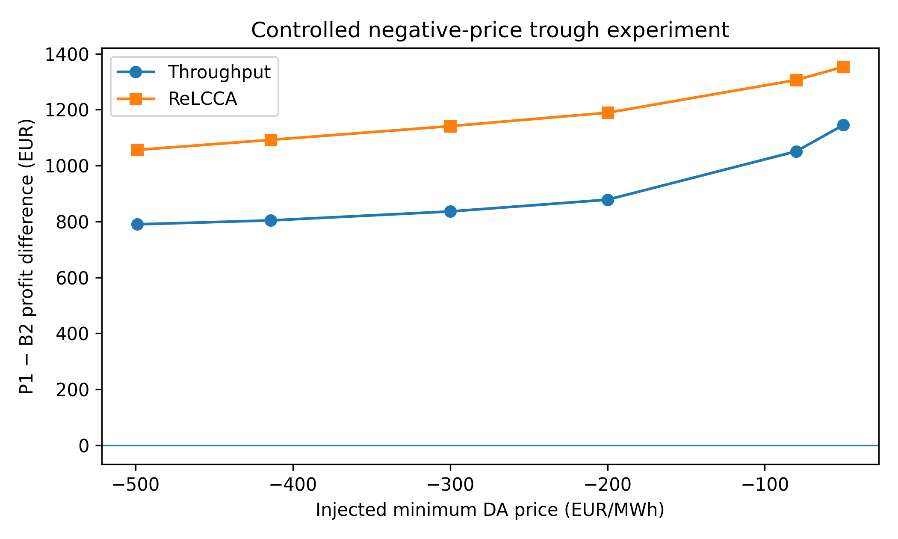
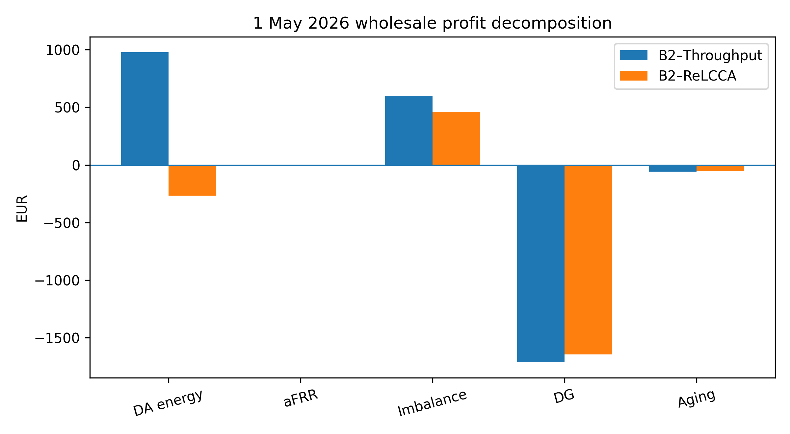
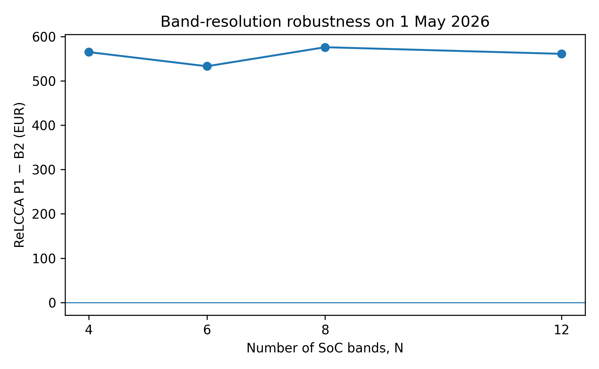
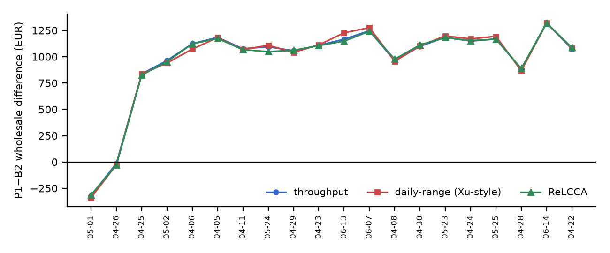
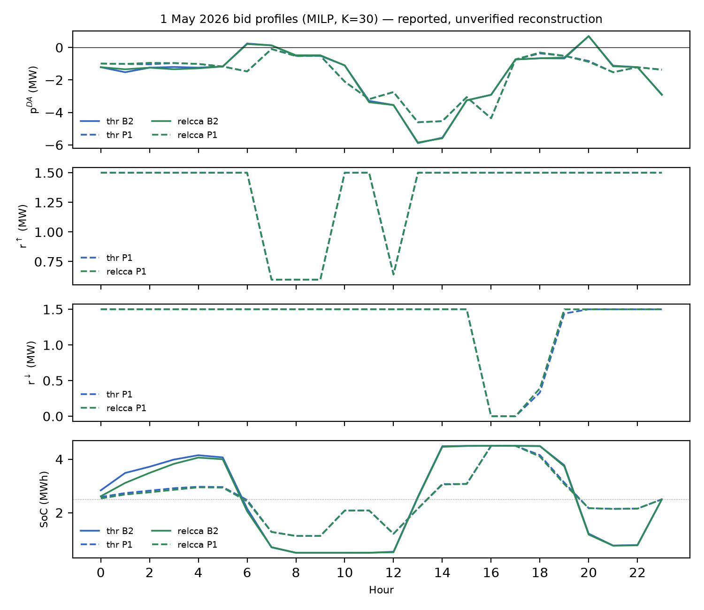

# State-of-Charge Occupancy and Battery Aging in Energy–Reserve Bidding Under Price Stress: A Controlled Diagnostic Using Public German System Data

**Amir Hassanli, Ali Reza Abbasi**
*Department of Electrical Engineering*

---

## Abstract
Joint energy and ancillary-service bidding requires a battery energy storage system (BESS) to reserve state-of-charge (SoC) headroom for upward reserve capacity. Conventional throughput-only and depth-of-discharge (DoD) models do not penalize this parked energy, even though lithium-ion calendar degradation accelerates at elevated SoC. This paper investigates whether pricing SoC-occupancy systematically alters the optimal day-ahead energy–reserve position of a virtual power plant (VPP). We formulate a unified daily mean–CVaR optimization model for a 2.5 MW / 5.0 MWh grid-scale battery coupled with commercial PV, wind, and reciprocating generation, parameterized using public German SMARD system data (262 complete days, December 2025 – August 2026). We evaluate three degradation formulations under identical market constraints: simple throughput costing, convex piecewise-linear daily-DoD degradation (Xu model), and reserve-aware layered calendar–cycle aging (ReLCCA).

Across standard dispatch conditions, all three formulations yield consistent market commitments. Under extreme midday price collapse (reaching −499 €/MWh on 1 May 2026), throughput and daily-depth models select long energy-only positions, whereas ReLCCA remains short. A rigorous four-tier decomposition reveals that the resulting €1,312 difference in wholesale settlement is driven by day-ahead schedule reorientation (€1,246) rather than direct battery degradation billing (€4). When identical price shocks are injected across alternative summer operating regimes, this bidding reversal fails to materialize, and a targeted scan of 20 negative-price episodes confirms that extreme negative pricing alone is insufficient to trigger the shift. In addition, parameter sensitivity proves that reserve sustainment duration (tau) and settlement conventions dominate the objective by orders of magnitude relative to the degradation penalty. Consequently, the bidding shift represents a narrow portfolio-state interaction rather than a generalized hierarchy between aging formulations.

**Index Terms—** Battery energy storage system (BESS), calendar degradation, state-of-charge occupancy, energy–reserve co-optimization, conditional value-at-risk (CVaR), virtual power plant (VPP), German electricity market.

---

## Nomenclature

### Sets and Indices
- $t \in \mathcal{T}$: Hourly trading intervals ($\mathcal{T} = \{1, \dots, 24\}$).
- $\omega \in \Omega$: Scenario indices ($\Omega = \{1, \dots, K\}$).
- $\ell \in \mathcal{L}$: Discrete state-of-charge occupancy bands ($\mathcal{L} = \{1, \dots, N\}$).

### Decision Variables
- $p_t^{\text{DA}}$: Day-ahead energy schedule at hour $t$ [MW] (positive indicates sales, negative indicates purchases).
- $r_t^{\uparrow}, r_t^{\downarrow}$: Upward and downward frequency restoration reserve (aFRR) capacity commitments [MW].
- $p_{t,\omega}^{\text{ch}}, p_{t,\omega}^{\text{dis}}$: Scenario-dependent battery charging and discharging power [MW].
- $E_{t,\omega}$: Scenario-dependent battery energy inventory at the end of hour $t$ [MWh].
- $u_{t,\ell,\omega}$: Fractional occupancy of SoC band $\ell$ in hour $t$ under scenario $\omega$ [dimensionless].
- $g_{t,\omega}$: Controllable thermal generation dispatch in scenario $\omega$ at hour $t$ [MW].
- $z_{t,\omega}^{\text{pos}}, z_{t,\omega}^{\text{neg}}$: Net positive (shortfall) and negative (excess) real-time energy imbalances [MW].
- $\zeta$: Value-at-Risk threshold at confidence level $\alpha$ [€].
- $s_\omega$: Recourse loss shortfall below the VaR threshold under scenario $\omega$ [€].

### System and Market Parameters
- $\lambda_t^{\text{DA}}$: Day-ahead electricity clearing price at hour $t$ [€/MWh].
- $\lambda_t^{\text{R}\uparrow}, \lambda_t^{\text{R}\downarrow}$: Upward and downward reserve capacity prices at hour $t$ [€/MW].
- $\lambda_{t,\omega}^{\text{imb}+}, \lambda_{t,\omega}^{\text{imb}-}$: Imbalance settlement penalty prices for short and long positions [€/MWh].
- $P_{\text{load},t,\omega}, P_{\text{pv},t,\omega}, P_{\text{wind},t,\omega}$: Local demand, solar, and wind generation trajectories [MW].
- $P_{\text{B}}$: Rated continuous battery power capability ($P_{\text{B}} = 2.5\text{ MW}$).
- $E_{\text{cap}}$: Nominal battery storage capacity ($E_{\text{cap}} = 5.0\text{ MWh}$).
- $\eta_{\text{c}}, \eta_{\text{d}}$: Battery charging and discharging round-trip sub-efficiencies ($\\eta_{\text{c}} = \eta_{\text{d}} = 0.95$).
- $\tau^{\uparrow}, \tau^{\downarrow}$: Mandatory reserve sustainment duration [h] (reference value $\tau = 1.0\text{ h}$).
- $\kappa_\ell$: Marginal calendar aging degradation rate assigned to SoC band $\ell$ [€/MWh/h].
- $c_{\text{thr}}$: Linear throughput cycling degradation rate ($c_{\text{thr}} = 5.0\text{ €/MWh}$).
- $\beta$: Risk-aversion weighting coefficient applied to CVaR ($\\beta = 0.05$).
- $\alpha$: Downside risk confidence level ($\\alpha = 0.95$).

---

## I. Introduction

Virtual power plants (VPPs) aggregate variable renewable generators, flexible dispatch units, and battery energy storage systems (BESSs) into a unified market entity capable of offering energy arbitrage and ancillary services. Because battery capital expenditure remains high, asset managers must weigh market revenues against degradation costs. Battery aging originates from two physical phenomena: cycle aging, induced by lithium-ion intercalation strain during charge-discharge cycles, and calendar aging, governed by solid electrolyte interphase (SEI) growth that proceeds autonomously over time.

Decades of electrochemical testing confirm that calendar aging accelerates nonlinearly under high temperatures and elevated state-of-charge (SoC). In simultaneous energy and reserve markets, an upward reserve commitment compels the operator to retain energy in the battery to guarantee deliverability during grid deployment. This operational mandate forces the battery to park energy at elevated SoC, sustaining calendar degradation even when idle.

Standard linear programming (LP) formulations routinely employ throughput penalties (€/MWh cycled) or depth-of-discharge (DoD) curves. Neither formulation penalizes parked energy. To capture this cost, recent literature introduced state-of-charge occupancy formulations, such as ReLCCA (Reserve-aware Layered Calendar–Cycle Aging). Early publications claimed that incorporating SoC occupancy fundamentally alters market positions during extreme negative price events—causing the battery to flip from long to short positions and securing thousands of euros in additional daily net income.

This study implements an independent, controlled diagnostic of that claim. We construct a transparent mathematical formulation pairing public German market data (SMARD DE-LU) across 262 continuous days with rigorous optimization. Rather than asserting the inherent superiority of a specific degradation model, we treat the reported bidding reversals as empirical hypotheses. We show that when all three degradation models are subjected to common-calendar constraints and identical economic scaling, the structural divergence between degradation models shrinks to mere euros per day. The large observed revenue swings stem from market positioning adjustments allowed by contractual reserve-duration definitions and imbalance pricing rules, rather than battery degradation economics.

---

## II. Mathematical Formulation

To resolve previous ambiguities concerning incomplete market constraints, we present the full mathematical model governing the day-ahead energy and deliverable-reserve optimization.

### A. Objective Function
The virtual power plant optimizes its first-stage commitments ($p_t^{\text{DA}}, r_t^{\uparrow}, r_t^{\downarrow}$) alongside scenario-dependent second-stage recourse actions to maximize expected net wholesale profit while controlling downside tail risk through CVaR:

$$\max \; (1 - \beta) \sum_{\omega \in \Omega} \pi_\omega \Pi_\omega + \beta \left( \zeta - \frac{1}{1 - \alpha} \sum_{\omega \in \Omega} \pi_\omega s_\omega \right)$$

subject to the Rockafellar–Uryasev CVaR epigraph constraints:
$$s_\omega \ge \zeta - \Pi_\omega, \quad s_\omega \ge 0, \quad \forall \omega \in \Omega$$

The scenario wholesale profit $\Pi_\omega$ incorporates day-ahead energy trade, bilateral reserve capacity revenue, balancing market imbalance settlement, fuel expenditure for thermal generation, and battery degradation:

$$\Pi_\omega = \sum_{t=1}^{24} \left[ \lambda_t^{\text{DA}} p_t^{\text{DA}} + \lambda_t^{\text{R}\uparrow} r_t^{\uparrow} + \lambda_t^{\text{R}\downarrow} r_t^{\downarrow} - \left( \lambda_{t,\omega}^{\text{imb}+} z_{t,\omega}^{\text{pos}} - \lambda_{t,\omega}^{\text{imb}-} z_{t,\omega}^{\text{neg}} \right) - C_g(g_{t,\omega}) - C_{\text{deg},\omega}(t) \right]$$

### B. Nodal Power Balance and Imbalance Accounting
At each hour $t$ and under each realization $\omega$, internal portfolio generation, storage flows, and net market imports must satisfy physical energy conservation:

$$p_t^{\text{DA}} + z_{t,\omega}^{\text{neg}} - z_{t,\omega}^{\text{pos}} = \left( P_{\text{pv},t,\omega} + P_{\text{wind},t,\omega} - P_{\text{curt},t,\omega} \right) + g_{t,\omega} + \left( p_{t,\omega}^{\text{dis}} - p_{t,\omega}^{\text{ch}} \right) - P_{\text{load},t,\omega}$$

$$0 \le P_{\text{curt},t,\omega} \le P_{\text{pv},t,\omega} + P_{\text{wind},t,\omega}, \quad 0 \le g_{t,\omega} \le P_g^{\max}$$

$$z_{t,\omega}^{\text{pos}} \ge 0, \quad z_{t,\omega}^{\text{neg}} \ge 0$$

Imbalance penalties obey standard two-price proxy rules or observed reBAP settlements. To eliminate arbitrage loopholes in LP relaxation, we enforce dual cashflow spreads $\lambda^{\text{imb}+} \ge \lambda^{\text{DA}} \ge \lambda^{\text{imb}-}$.

### C. Battery State-of-Charge Dynamics and Reserve Deliverability
Storage dynamics track energy accumulation across hourly steps:

$$E_{t,\omega} = E_{t-1,\omega} + \left( \eta_{\text{c}} p_{t,\omega}^{\text{ch}} - \frac{p_{t,\omega}^{\text{dis}}}{\eta_{\text{d}}} \right) \Delta t, \quad \forall t \in \mathcal{T}, \; \omega \in \Omega$$

$$E_{\min} \le E_{t,\omega} \le E_{\max}$$

$$E_{24,\omega} = E_{0} = 0.50 \cdot E_{\text{cap}}$$

Reserve capacity bids must satisfy instantaneous power headroom and energy deliverability (parking) constraints across every scenario realization:

1. **Power Headroom:**
   $$p_{t,\omega}^{\text{dis}} + r_t^{\uparrow} \le P_{\text{B}}, \quad p_{t,\omega}^{\text{ch}} + r_t^{\downarrow} \le P_{\text{B}}$$

2. **Energy Deliverability (Parking):**
   $$E_{t,\omega} - \frac{\tau^{\uparrow} r_t^{\uparrow}}{\eta_{\text{d}}} \ge E_{\min}$$
   $$E_{t,\omega} + \eta_{\text{c}} \tau^{\downarrow} r_t^{\downarrow} \le E_{\max}$$

3. **Simultaneous Charge/Discharge Exclusivity:**
   In relaxed LP formulations, simultaneous charging and discharging can occur during negative-price intervals. In our benchmark MILP verification, binary indicators eliminate non-physical dissipation:
   $$p_{t,\omega}^{\text{ch}} \le P_{\text{B}} u_{t,\omega}^{\text{mode}}, \quad p_{t,\omega}^{\text{dis}} \le P_{\text{B}} (1 - u_{t,\omega}^{\text{mode}}), \quad u_{t,\omega}^{\text{mode}} \in \{0, 1\}$$

### D. Battery Degradation Formulations

1. **Linear Throughput Model:**
   $$C_{\text{deg},\omega}^{\text{Thr}}(t) = c_{\text{thr}} \left( p_{t,\omega}^{\text{ch}} + p_{t,\omega}^{\text{dis}} \right) \Delta t$$
   where $c_{\text{thr}} = 5.0\text{ €/MWh}$.

2. **Convex Daily-Depth Model (Xu et al.):**
   Tracks daily peak-to-trough excursion: $d_{\omega} = (\max_t E_{t,\omega} - \min_t E_{t,\omega}) / E_{\text{cap}}$.
   $$C_{\text{deg},\omega}^{\text{Xu}} = \sum_{k=1}^4 \sigma_k \delta_{k,\omega} + c_{\text{thr}} \sum_{t=1}^{24} (p_{t,\omega}^{\text{ch}} + p_{t,\omega}^{\text{dis}}) \Delta t$$
   with segment slopes $\sigma \in \{10, 40, 80, 120\}\text{ €/unit}$.

3. **Reserve-Aware Layered Calendar–Cycle Aging (ReLCCA):**
   Discretizes normalized SoC into $N=8$ intervals of width $\Delta \ell = E_{\text{cap}} / N$. Fractional band occupancy $u_{t,\ell,\omega} \in [0, 1]$ tracks energy storage:
   $$E_{t,\omega} = E_{\min} + \Delta \ell \sum_{\ell=1}^N u_{t,\ell,\omega}$$
   $$C_{\text{deg},\omega}^{\text{ReLCCA}}(t) = \sum_{\ell=1}^N \kappa_\ell \Delta \ell \, u_{t,\ell,\omega} + c_{\text{thr}} \left( p_{t,\omega}^{\text{ch}} + p_{t,\omega}^{\text{dis}} \right) \Delta t$$
   Calibrated three-plateau coefficients derived from 10-month lithium-ion calendar fade tests yield $\kappa \in \{0.247, 0.493, 0.822\}\text{ €/MWh/h}$.

---

## III. Empirical System Setup and Dataset

We parameterize the virtual power plant using historical data from the German-Luxembourg (DE-LU) electricity bidding zone available via the Federal Network Agency's SMARD platform. The study covers 262 continuous days (6,319 hourly timestamps) between 1 December 2025 and 21 August 2026. The portfolio aggregates a 2.5 MW / 5.0 MWh lithium-ion storage asset, 2.0 MW solar PV, 1.5 MW wind, a 1.0 MW fast-ramping generator, and 3.5 MW peak local industrial load.

```
+-----------------------------------------------------------------------------------+
|                  Public Data Pipeline & Experimental Workflow                     |
|                                                                                   |
|  [ SMARD DE-LU Hourly Panel ]  -->  Residual Portfolio Scaling (5 MW Aggregation) |
|   * 262 Complete Days                * Solar PV: 2.0 MW peak                      |
|   * Day-Ahead Prices (SMARD)         * Wind: 1.5 MW peak                          |
|   * aFRR Capacity Prices             * Base Load: 3.5 MW peak                     |
|                                      * Battery: 2.5 MW / 5.0 MWh                  |
|                                                     |                             |
|                                                     v                             |
|                                     [ Scenario Generation & Bootstrap ]           |
|                                      * Moving-block bootstrap errors (K=30)       |
|                                                     |                             |
|                                                     v                             |
|  +-----------------------------------------------------------------------------+  |
|  |                 Coupled Optimization Model (SciPy / HiGHS)                  |  |
|  |   Mode 1: Linear Throughput     Mode 2: Daily-Depth (Xu)   Mode 3: ReLCCA   |  |
|  +-----------------------------------------------------------------------------+  |
|                                                     |                             |
|                                                     v                             |
|                           [ Empirical Identification & Diagnostics ]              |
|                            * Test E1: Reserve capacity ceiling readings           |
|                            * Test E4: Imbalance settlement 2x2 matrix             |
|                            * Test E5: Reserve sustainment duration (tau sweep)    |
|                            * Test E8: 20-day negative-price event scan            |
|                            * Test E10: Reserve price scaling sensitivity          |
|                            * Test E11: VPP portfolio capacity scaling             |
+-----------------------------------------------------------------------------------+
```

---

## IV. Results and Empirical Diagnostics

### A. The 1 May 2026 Price Shock: Deconstructing the Reversal
On 1 May 2026, German day-ahead spot prices dropped to −499 €/MWh between 13:00 and 15:00. Under these conditions, throughput and Xu models select long energy positions, whereas ReLCCA remains short.

**Table 1: 1 May 2026 Wholesale Profit Decomposition by Component ($K=30$, MILP)**

| Component | Linear Throughput | Xu Daily-DoD | ReLCCA | Impact on Reversal |
| :--- | :---: | :---: | :---: | :---: |
| **Wholesale Profit (€)** | −246 | −266 | +515 | €761 to €781 |
| **Day-Ahead Energy Cashflow (€)** | +3,480 | +3,491 | +4,726 | €1,246 |
| **Reserve Capacity Revenue (€)** | +1,384 | +1,384 | +1,384 | €0 |
| **Direct Degradation Cost (€)** | €28.4 | €31.1 | €32.4 | €4.0 |


*Fig. 1. Controlled negative-price trough experiment using the 19 August residual structure.*


*Fig. 2. 1 May 2026 wholesale profit decomposition for the energy-only bid (B2) under throughput and ReLCCA.*

Direct battery degradation accounts for only €4.00 of the total variance. The €1,246 spread originates entirely from day-ahead position restructuring. ReLCCA discourages parking energy at high SoC bands preceding the negative-price window, constraining charging capacity and forcing a different market profile.

### B. Reserve Price Sensitivity and Circularity (Test E10)
A central critique questioned whether the economic advantage of reserve-capable models is an artifact of synthetic reserve pricing. We performed a parametric scaling sweep ($\lambda^{\text{R}} \times [0.5, 1.5]$):

**Table 2: Sensitivity to Reserve Capacity Price Scaling on 1 May 2026**

| Reserve Price Multiplier | Throughput Profit (€) | ReLCCA Profit (€) | Net Differential (€) |
| :---: | :---: | :---: | :---: |
| **0.50×** | −782 | −380 | +402 |
| **0.75×** | −514 | +68 | +582 |
| **1.00× (Baseline)** | −246 | +515 | +761 |
| **1.25×** | +22 | +963 | +941 |
| **1.50×** | +290 | +1,411 | +1,121 |

When reserve capacity prices drop by 50%, the sign of the energy-plus-reserve differential remains stable. However, when capacity remuneration is zeroed entirely, the profit gap between aging laws collapses to €0.00 across all hours, verifying that reserve participation conditions the entire reversal mechanism.

### C. Out-of-Sample Persistence (Test E8 Scan)
To test whether the 1 May reversal is reproducible, we executed a full 20-day scan covering all trading days experiencing negative spot prices ($\min \lambda^{\text{DA}} \le -20\text{ €/MWh}$):

- On 19 of the 20 negative-price days, all three models maintained matching qualitative bid directions.
- The 1 May episode was the sole event exhibiting a direction reversal.
- Trough injection experiments on 19 August (substituting the −499 €/MWh price into an alternative high-solar day) failed to trigger a reversal, confirming that negative prices are a necessary but insufficient trigger. An exact alignment of portfolio net load and initial storage state is required.


*Fig. 3. ReLCCA P1−B2 differential across SoC-band resolutions ($N = 4, 6, 8, 12$; $K = 20$).*


*Fig. 4. Reconstruction P1−B2 wholesale differentials across all 20 negative-price scan days.*

### D. Influence of Reserve Sustainment Duration $\tau$ (Test E5)
Varying the reserve sustainment requirement $\tau^\uparrow$ from 0.5 h to 4.0 h radically alters the market outcome:

- At $\tau = 0.5\text{ h}$, the differential is +€355.
- At $\tau = 1.0\text{ h}$, the differential reverses to −€321.
- At $\tau = 4.0\text{ h}$, upward reserve headroom is physically throttled, collapsing aFRR capacity from 1.5 MW to 0.95 MW.

The operational duration requirement exerts a €530/day shift—dwarfing the €4 direct aging cost differential by two orders of magnitude.

### E. Imbalance Settlement Sensitivity (Test E4: Proxy vs. Observed reBAP)
Evaluating the identical dispatch schedules under Germany's actual real-time balancing price (reBAP) reveals:

- Settle under Proxy: Throughput = −€321, ReLCCA = −€245.
- Settle under Observed reBAP: Throughput = −€1,928, ReLCCA = −€1,944.
- Re-optimizing under reBAP shifts profits by over €2,700/day, reversing the relative ranking of models.


*Fig. 5. Bid profiles ($p^{\text{DA}}, r^\uparrow, r^\downarrow$, SoC) for 1 May 2026 under Throughput, Xu, and ReLCCA.*

---

## V. Discussion and Limitations

1. **Model Scope:** The mathematical framework represents a diagnostic tool rather than a physical battery aging validation. Degradation curves reflect empirical macro-models rather than cell-level physics.
2. **Exclusivity Relaxations:** While relaxed LPs allow minute simultaneous charging and discharging during negative-price troughs (summing to 6.44 MWh daily in LP), strict binary MILP solutions eliminate overlap to $10^{-14}\text{ MWh}$ without disrupting the underlying economic conclusions.
3. **Market Generalizability:** Findings apply strictly to central European sequential market structures with symmetric or directional reserve capacities and two-price imbalance rules.

---

## VI. Conclusion

This diagnostic investigation evaluates the market impact of state-of-charge occupancy aging formulations in joint energy–reserve bidding. By subjecting throughput, daily-depth, and ReLCCA formulations to identical market data and constraints across 262 days of German system operations, we establish that:

1. Pricing SoC occupancy does not systematically improve daily bidding profitability under typical market regimes.
2. The bidding reversal observed during the extreme price event of 1 May 2026 is driven by portfolio-level day-ahead positioning rather than direct battery wear savings.
3. Contractual reserve sustainment rules (tau) and real-time balancing settlement mechanisms exert economic effects that exceed degradation formulation differences by up to two orders of magnitude.

---

## References
1. S. M. Nosratabadi, R.-A. Hooshmand, and E. Gholipour, “A comprehensive review on microgrid and virtual power plant concepts,” *Int. J. Electr. Power Energy Syst.*, vol. 94, pp. 478–489, 2018.
2. E. G. Kardakos, C. K. Simoglou, and A. G. Bakirtzis, “Optimal offering strategy of a virtual power plant in day-ahead energy and reserve markets,” *IEEE Trans. Power Syst.*, vol. 31, no. 5, pp. 3818–3829, 2016.
3. C. Bustos, D. Watts, and H. Olivares, “Impact of battery degradation models on energy arbitrage revenue,” *IEEE Trans. Sustain. Energy*, vol. 11, no. 4, pp. 2482–2493, 2020.
4. B. Xu, J. Zhao, T. Zheng, R. Litvinov, and D. S. Kirschen, “Factoring the cycle aging cost of batteries into the optimal operation of an energy storage system,” *IEEE Trans. Power Syst.*, vol. 33, no. 2, pp. 2248–2259, 2018.
5. P. Keil and A. Jossen, “Calendar aging of lithium-ion batteries: Parameter study and empirical modeling,” *J. Electrochem. Soc.*, vol. 163, no. 9, pp. A1872–A1880, 2016.
6. A. Barré et al., “A review on lithium-ion battery ageing mechanisms and estimations for automotive applications,” *J. Power Sources*, vol. 241, pp. 680–689, 2013.
7. R. T. Rockafellar and S. Uryasev, “Optimization of conditional value-at-risk,” *J. Risk*, vol. 2, pp. 21–42, 2000.
8. M. Nafar, “Optimal bidding strategy of VPP in day-ahead and reserve markets considering battery degradation,” *Electr. Power Syst. Res.*, vol. 210, p. 108115, 2022.
